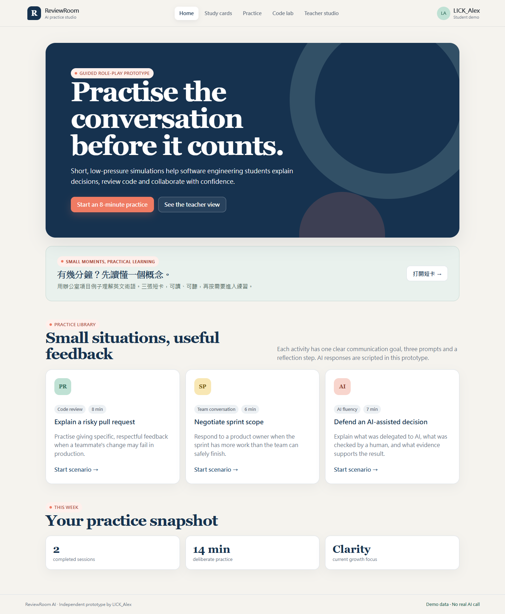
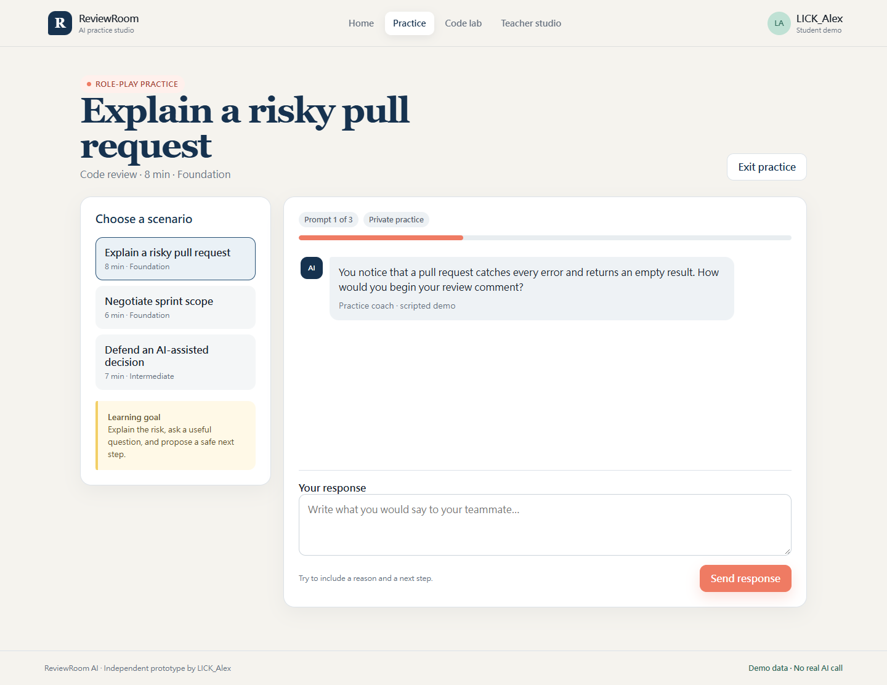
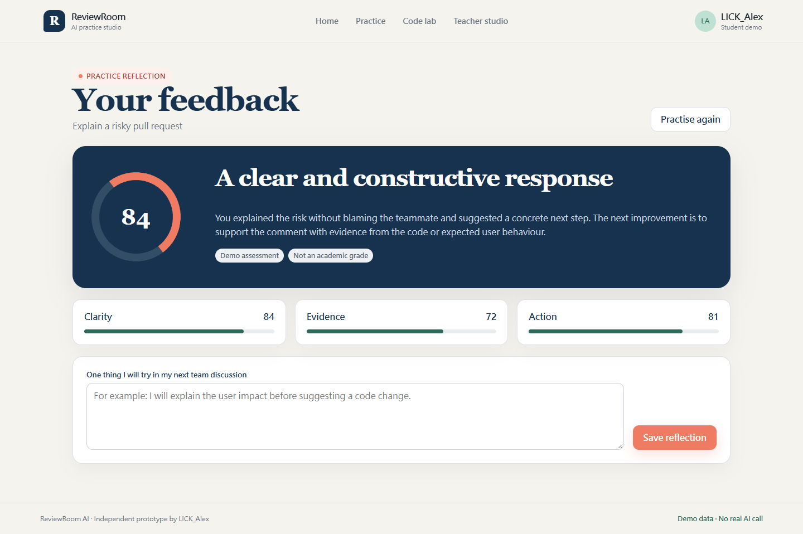
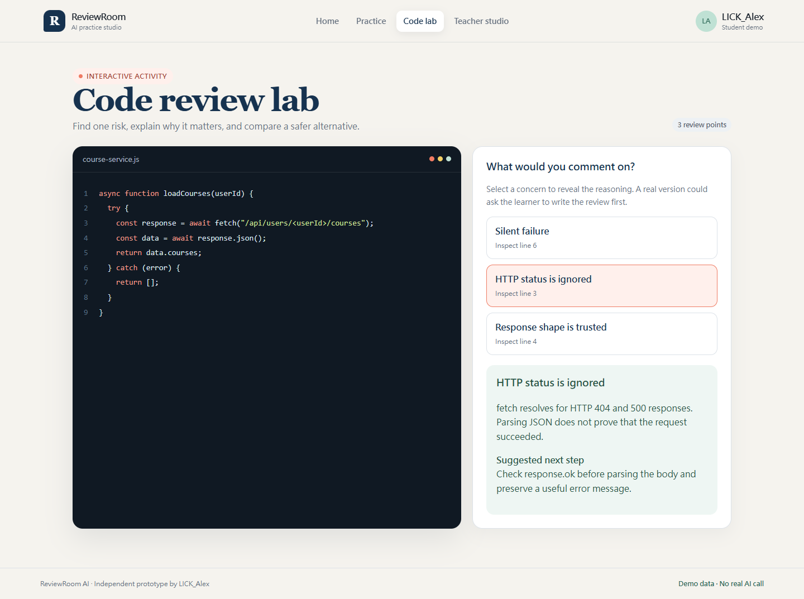
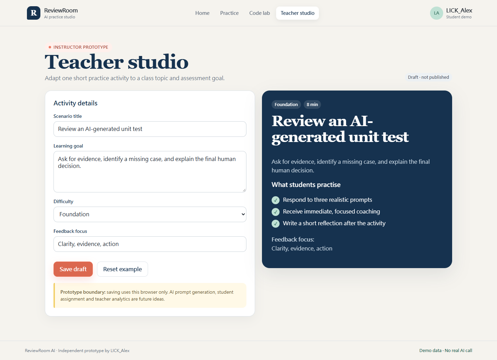
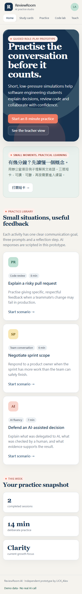
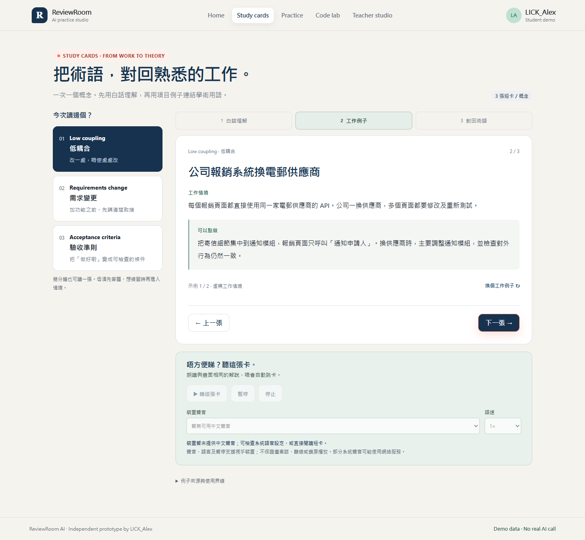
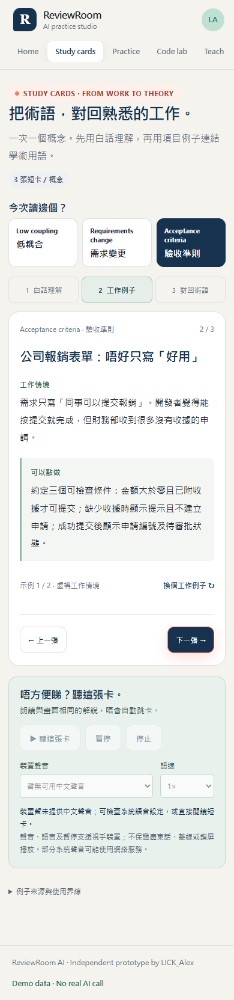

# ReviewRoom AI

**Owner:** LICK_Alex (`alexlearning123`)  
**Branch:** `dev/LICK_Alex`  
**Prototype type:** frontend-only interaction prototype

ReviewRoom AI is a small practice studio for software engineering conversations. It helps students rehearse code-review feedback, sprint-scope discussions and AI-assisted development decisions before having those conversations in a real team.

The prototype responds to one gap in technical education: students may understand a concept but still find it difficult to explain a risk, question a decision or give constructive feedback. Short role-play activities make those soft and product skills visible and repeatable.

## Target users and problem

- **Primary user:** a student learning software development or preparing for project work.
- **Secondary user:** an instructor who wants to adapt a short communication exercise to a class topic.
- **Problem:** passive reading and ordinary AI question-answering do not give students enough practice in explaining decisions to another person.
- **Idea:** use a guided AI role-play with a clear goal, three short prompts, immediate coaching and a final reflection.

## What can be demonstrated

1. Choose one of three practice scenarios.
2. Respond to three realistic prompts in a guided conversation.
3. Read scripted coaching after each response.
4. Review a feedback summary with clarity, evidence and action scores.
5. Save a personal reflection in the browser.
6. Inspect a small JavaScript example in the Code Review Lab and reveal three review concerns.
7. Use Teacher Studio to edit an activity title, goal, difficulty and feedback focus, then save the draft locally.
8. Use the same interface at desktop and mobile widths.
9. Open **Study cards** for three software-project concepts: low coupling, requirements change and acceptance criteria. Each has three short cards: plain-language explanation → workplace example → connection back to the term. Switch between two prepared examples per concept.
10. Read the Traditional Chinese explanations alongside English terms, or listen to the current card using a compatible device voice. Playback is optional; a related role-play remains a separate next step.

## Run locally

No package installation, account or API key is required. Use any simple local web server from the repository root.

Python:

```sh
python -m http.server 4173
```

Then open <http://127.0.0.1:4173/>.

Opening `index.html` directly also works in modern browsers, but a local server is recommended for a consistent demonstration.

## Technology

- Semantic HTML
- Responsive CSS
- Plain JavaScript
- Browser `localStorage` for the teacher draft and student reflection
- Browser `speechSynthesis` for optional card narration; no TTS API key
- No framework, backend, database, external font or remote asset

## Prototype boundaries

- The AI coach is explicitly simulated with prepared prompts and feedback. No LLM request is made.
- Scores are illustrative feedback, not a validated assessment or academic grade.
- Teacher drafts and reflections stay in the current browser only.
- There is no authentication, class enrolment, analytics dashboard or shared course storage.
- No stakeholder interview or external usability test has been completed yet.
- Study cards are authored examples, not real client case studies or content extracted from course slides. Further-reading links are not course citations.
- Narration depends on installed/available Chinese voices. Cantonese, offline playback, pause/resume and background playback are device-dependent; some voices may use a network service. All content remains readable when speech is unavailable.
- Card position stays in memory during navigation but resets on reload. Reading a card does not count as demonstrated mastery or change the demo scores.

These boundaries keep the prototype focused on validating the interaction idea instead of pretending that unfinished infrastructure already exists.

## Validation

The complete student flow, Code Review Lab, Teacher Studio local save and mobile layout were exercised in Chrome on 17 October 2026. The checked flow produced no JavaScript console or page errors. Full details are in [the validation record](docs/VALIDATION.md).

The Study cards addition passed 67 automated browser assertions, including existing-flow regression checks. Speech controls were tested with a mocked engine; the native headless browser exposed no voices, so audible output and pronunciation have not been verified.

## Design and validation material

- [Design rationale and future ideas](docs/DESIGN.md)
- [Validation record](docs/VALIDATION.md)

## Screenshots

All screenshots below come from the running prototype.

| Home and scenario library | Guided role-play |
| --- | --- |
|  |  |

| Feedback and reflection | Code Review Lab |
| --- | --- |
|  |  |

| Teacher Studio | Mobile home |
| --- | --- |
|  |  |

| Workplace study cards | Mobile study cards |
| --- | --- |
|  |  |

## Contribution record

LICK_Alex proposed the product direction, defined the scope and user flow, selected and reviewed the three learning scenarios, made the key design decisions, and owns this independent prototype and its presentation. AI-assisted development.
